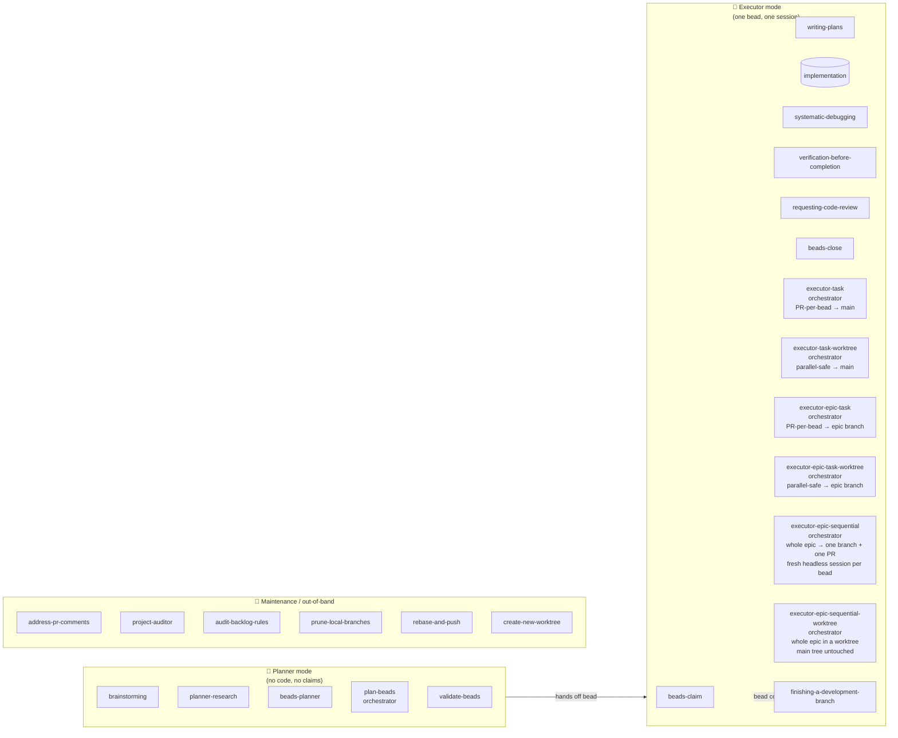
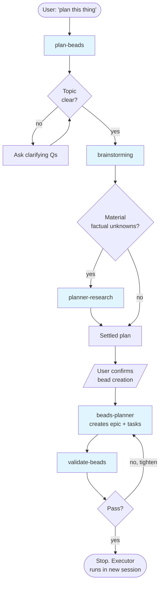
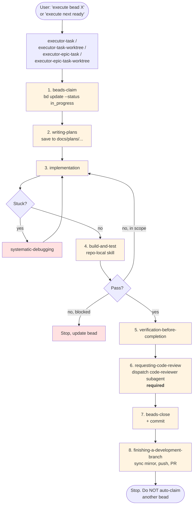
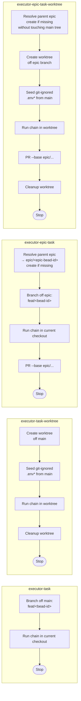

# Skills Relationships

A map of every skill under `skills/` — what each one does, who calls it, who it calls, and where it sits in the overall workflow. Read this before customizing or adding a skill so the new piece slots into an existing seam instead of creating a parallel one.

The canonical end-user description of the workflow lives in `templates/BEADS_WORKFLOW.md` (which is what gets shipped into downstream repos). This document is the _internal_ view: the skills as a graph.

---

## 1. The two execution modes

Every skill belongs to exactly one of two modes (plus maintenance ops that sit alongside). The mode boundary is what the `<HARD-GATE>` blocks in many SKILL.md files are protecting.

**Hard rule encoded in the diagram:** planner skills must NOT invoke executor skills. The bead-creation handoff is the _only_ legal exit from planner mode.

**Maintenance skills** are user-invoked at any point and don't belong to a phase: they sit alongside the workflow rather than inside it. They may dispatch internal subagents (see §5.5) but never claim, plan, or close beads.

---

## 2. Skill catalog (one-liner per skill)

| Skill                            | Mode                            | Role                                               | Invoked by                                                                | Invokes                                                                            |
| -------------------------------- | ------------------------------- | -------------------------------------------------- | ------------------------------------------------------------------------- | ---------------------------------------------------------------------------------- |
| `brainstorming`                  | planner                         | Turn fuzzy idea into a settled design              | `plan-beads`, user                                                        | `planner-research` (optional)                                                      |
| `planner-research`               | planner                         | Resolve factual unknowns before bead creation      | `brainstorming`, `plan-beads`                                             | —                                                                                  |
| `beads-planner`                  | planner                         | Translate settled plan into epic + tasks           | `plan-beads`                                                              | —                                                                                  |
| `plan-beads`                     | planner (orchestrator)          | Run a full planner session end-to-end              | user                                                                      | `brainstorming` → `planner-research` → `beads-planner` → `validate-beads`          |
| `validate-beads`                 | planner                         | Quality gate before execution                      | `plan-beads`, user                                                        | —                                                                                  |
| `beads-claim`                    | executor                        | Find + claim one ready bead                        | `executor-task` orchestrators, user                                       | —                                                                                  |
| `writing-plans`                  | executor                        | Write the implementation plan for the claimed bead | `executor-task` orchestrators, user                                       | `requesting-code-review` (for plan review during chunked drafting)                 |
| `systematic-debugging`           | executor                        | Root-cause investigation when blocked              | implementation step                                                       | —                                                                                  |
| `responsive-layout-testing`      | executor (opt-in, `--with-web`) | Screenshot a page at 6 widths via Chrome DevTools MCP, fix overflow/layout breaks | implementation step, user                                  | `systematic-debugging`, `verification-before-completion` (defers completion claim) |
| `prepare-android-chrome`         | executor (opt-in, `--with-web`) | Prepare a USB-connected Android phone so Chrome on it can be driven via the `chrome-devtools-android` MCP | user                                                                      | —                                                                                  |
| `verification-before-completion` | executor                        | Evidence-before-claims gate                        | `executor-task` orchestrators                                             | —                                                                                  |
| `requesting-code-review`         | executor                        | Dispatch the local code-reviewer subagent (`.claude/agents/code-reviewer.md`) | `executor-task` orchestrators (required, not optional)                    | —                                                                                  |
| `beads-close`                    | executor                        | Close bead + create follow-ups + commit            | `executor-task` orchestrators, user                                       | —                                                                                  |
| `executor-task`                  | executor (orchestrator)         | One bead delivered as its own PR off a fresh branch from main | user                                                                      | `beads-claim` → `writing-plans` → impl → `build-and-test` → verify → `beads-close` → `finishing-a-development-branch` |
| `executor-task-worktree`         | executor (orchestrator)         | Same as `executor-task`, but in an isolated git worktree (parallel-safe) | user                                                                      | same chain as `executor-task`                                                      |
| `executor-epic-task`             | executor (orchestrator)         | Same as `executor-task` but branches off (and PRs into) the bead's parent epic branch `epic/<epic-bead-id>` (bead id only, no slug); auto-creates the epic branch from the default branch if missing | user                                                                      | same chain as `executor-task`                                                      |
| `executor-epic-task-worktree`    | executor (orchestrator)         | Same as `executor-epic-task`, but in an isolated git worktree (parallel-safe; never touches the main checkout) | user                                                                      | same chain as `executor-task`                                                      |
| `executor-epic-sequential`       | executor (orchestrator)         | Run **all** ready beads of one epic sequentially on a single `epic/<epic-bead-id>` branch — each bead in a **fresh worker session** through the runner picked in preflight (Herdr agent the user starts, or a headless run of the driver's CLI); failures are blocked + skipped; ends with one PR epic → default branch | user                                                                      | `<RUNNER>` → a fresh executor cycle **per bead** (`beads-claim` → `writing-plans` → impl → `build-and-test` → verify → `requesting-code-review` → `beads-close`) → `finishing-a-development-branch` (once) |
| `executor-epic-sequential-worktree` | executor (orchestrator)      | Same as `executor-epic-sequential`, but runs the whole epic inside a sibling git worktree checked out on `epic/<epic-bead-id>` — never touches the main checkout; seeds git-ignored `.env*`; leaves the worktree in place for PR follow-up | user                                                                      | `<RUNNER>` → a fresh executor cycle **per bead** (in the worktree) → `finishing-a-development-branch` (once) → pairs with `cleanup-worktree` |
| `run-bead-in-herdr`             | executor                        | Inside Herdr: create or reuse the tab `<epic-id>-implementer` (cwd = the checkout), wait for the user to start Claude Code, OpenCode or omp there and reply `done`, check kind/status/cwd; per bead clear with the kind's command (`/clear` or `/new`), prompt from a file, confirm the new session id once the turn is `working`, chunked wait, dialogs to the user, timeout → kind's interrupt keys + force-block; leaves the tab open; no headless fallback | `executor-epic-sequential*`, when preflight prints `herdr …` | — |
| `run-bead-headless-claude`      | executor                        | Run one bead in a fresh `claude -p` (Opus 5.5, high effort, `--dangerously-skip-permissions`, JSON output), driver waits with `run_in_background` | `executor-epic-sequential*`, when preflight prints `headless claude` | — |
| `run-bead-headless-opencode`    | executor                        | Run one bead in a fresh `opencode run --standalone --yolo` from the checkout, stdin closed, OpenCode's default model; driver waits with `background: true` | `executor-epic-sequential*`, when preflight prints `headless opencode` | — |
| `run-bead-headless-omp`         | executor                        | Run one bead in a fresh `omp -p --yolo` from the checkout, stdin closed, omp's default model; driver waits with `timeout: 0` | `executor-epic-sequential*`, when preflight prints `headless omp` | — |
| `finishing-a-development-branch` | executor                        | Push the branch and create a PR                    | `executor-task`, `executor-task-worktree`, `executor-epic-task`, `executor-epic-task-worktree`, `executor-epic-sequential`, `executor-epic-sequential-worktree`, user | —                                                                                  |
| `address-pr-comments`            | maintenance                     | Iterative PR review-comment loop                   | user                                                                      | `pr-comment-fixer` subagent                                                        |
| `project-auditor`                | maintenance                     | Full-repo audit (naming, structure, light arch)    | user                                                                      | `project-auditor` subagent                                                         |
| `audit-backlog-rules`            | maintenance                     | Audit ready/blocked beads against current rules    | user                                                                      | —                                                                                  |
| `prune-local-branches`           | maintenance                     | Bulk-clean `[gone]`-upstream local branches **and their attached worktrees** (removes each worktree before deleting the branch); the bulk counterpart to `cleanup-worktree` | user                                                                      | —                                                                                  |
| `rebase-and-push`                | maintenance                     | Rebase the current branch onto its base — a feature branch onto its parent epic or default, or an epic branch onto the default branch (only when no open child PR targets it) — resolve conflicts, verify, force-push with lease | user                                                                      | `verification-before-completion`                                                   |
| `create-new-worktree`            | maintenance                     | Create + prepare a sibling worktree from a branch name or bead id off the default branch (seed `.env*`, opt-in extra ignored files, ask-then-install deps, ensure Beads health), then stop for an executor | user                                                                      | —                                                                                  |

> Note: `build-and-test` is **not** in `skills/` — it lives under `templates/skills/build-and-test/` because it is the one skill the downstream repo specializes (stage 2). The single source is always copied into `<downstream>/.claude/skills/build-and-test/`. Treat it as the implicit verification step in every executor chain.

---

## 3. Planner session flow (`plan-beads` orchestration)

**Key invariant:** the planner session ends at `DONE`. It does NOT invoke `beads-claim`, `writing-plans`, or any implementation skill. The user starts executor work in a _separate_ session.

---

## 4. Executor flow (`executor-task` / `executor-task-worktree` / `executor-epic-task` / `executor-epic-task-worktree`)

This is the canonical 8-step chain. All four orchestrators run the same chain — they only differ in **base branch** and **isolation**:

|                          | Current checkout              | Isolated worktree                    |
| ------------------------ | ----------------------------- | ------------------------------------ |
| **PR base = main**       | `executor-task`               | `executor-task-worktree`             |
| **PR base = epic branch**| `executor-epic-task`          | `executor-epic-task-worktree`        |

The `epic-*` variants resolve the parent epic from `bd show <BEAD_ID>` (or take an explicit epic id), branch off `epic/<epic-bead-id>` (bead id only, no slug — prevents duplicate epic branches from differing slugs), and target that same branch with `gh pr create --base`. If the epic branch does not exist, they create it from the latest default branch (the worktree variant uses `git branch` so the main tree stays untouched) and push it before cutting the feature branch.

**The four variants side by side:**

Use `executor-task` for the standard one-bead-per-PR rhythm into main. Use `executor-task-worktree` when you need to run multiple beads in parallel without branch interference in the main checkout. Use the `executor-epic-task` variants when the whole epic should land in main as a single merge and each child bead ships as its own PR into the epic branch.

### Worktree lifecycle bookends (`create-new-worktree` / `cleanup-worktree`)

The `executor-*-worktree` orchestrators above bundle worktree **setup + the full executor cycle + leave-in-place** in one shot. When you instead want to prepare an isolated worktree and *then* drive an executor by hand (or just work a plain branch), the lifecycle splits into two user-invoked maintenance bookends:

- **`create-new-worktree`** (setup bookend) — takes a branch name or a bead id/name, cuts a sibling worktree off the origin default branch, seeds its git-ignored `.env*`, optionally copies other git-ignored working files the user picks, asks-then-installs dependencies, and verifies Beads health inside the worktree — then **stops**. It never claims the bead, plans, or implements; it hands off to an executor (`cd` in, run the plain `executor-task` / `executor-epic-task`, *not* the `-worktree` variant, which would nest a second worktree).
- **`cleanup-worktree`** (teardown bookend) — removes a sibling worktree once its PR has landed (or been abandoned).

So the executor-agnostic flow is: `create-new-worktree` → (`cd` in) → `executor-task` → `cleanup-worktree`. This is distinct from `executor-task-worktree`, which is the all-in-one that owns setup, execution, and PR in a single invocation.

### Epic workers (epic-sequential pair)

`executor-epic-sequential` and `executor-epic-sequential-worktree` take only the epic id. In preflight a shell-independent Node one-liner reads `HERDR_ENV`, `OMPCODE` and `OPENCODE` (omp also sets `CLAUDECODE`, so `OMPCODE` is checked first) and picks `<RUNNER>`:

- `herdr …` → `run-bead-in-herdr`: the run creates (or reuses) the tab `<epic-id>-implementer` with the checkout as cwd and asks the user to start the CLI they want there; every bead runs in that agent, cleared before each bead with the kind's own command. The tab stays open. No headless fallback inside Herdr, and the user's own agents in other tabs are never used.
- `headless claude|opencode|omp` → `run-bead-headless-<cli>`: a fresh process of the driver's own CLI per bead, permissions bypassed.

Every runner gets the same inputs (`<CHECKOUT>`, `<BEAD_ID>`, `<PROMPT_FILE>`, `<RUN_TMP>`, `<WORKER_TIMEOUT>` = 3600 s) and the same shared task prompt, reads only the last `RESULT:` line, and leaves the outcome to `bd show`. A POSIX-shell gate (`timeout` must return 124) stops a driver whose shell tool is PowerShell (OpenCode's Windows default). A first-bead guard stops the run when the first bead is still `open` after its worker: the runner, not the bead, is broken.

### Whole-epic variant (`executor-epic-sequential`)

The four `executor-*-task` orchestrators each deliver **one** bead. `executor-epic-sequential` delivers a **whole epic** unattended: it creates the `epic/<epic-bead-id>` branch once, then loops over `bd ready --parent <epic-id>`, executing each ready bead in turn and committing it directly onto that single branch, until no ready beads remain. It ends with **one** PR (`epic/<epic-bead-id>` → default branch) — not one PR per bead.

Its distinguishing mechanic is **context isolation per task**: the driver does not run the executor chain in its own session. Instead each bead runs in a **fresh worker session** — a new headless process of the driver's CLI, or the cleared Herdr worker agent — which runs the full chain (including the review subagent, which a normal subagent could not nest) and is then discarded or cleared. The driver's context only accumulates short per-bead summaries plus `git`/`bd` output, so a long epic does not bloat or pollute it. Because the model cannot clear itself mid-run, a fresh process or a cleared separate agent is the only way to get a genuinely clean slate per task — so the driver must never "just do a bead inline" (enforced by `<HARD-GATE>`).

Failure handling is **skip-and-continue**: a bead that fails or blocks is marked `blocked` (outcome read from `bd show`, not the worker's self-report) and skipped; its dependents stay out of `bd ready` and are skipped too; the run finishes and reports everything that was delivered vs. blocked. Hard prereqs: the bead must be an epic, the working tree must be clean (no auto-stash), and the runner's CLI (or `herdr`) must be on `PATH`. This whole flow leans hard on **fresh-session-safe beads** — each worker sees only the bead contract and the code on the branch, never the planner chat.

**Worktree variant (`executor-epic-sequential-worktree`).** Same whole-epic mechanic — one epic branch, one fresh worker session per bead, skip-and-continue, one final PR — but instead of switching the **main** checkout onto the epic branch, it cuts a sibling git worktree at `../<repo>-epic-<epic-bead-id>`, checks that worktree out on `epic/<epic-bead-id>`, and runs the entire loop (every `bd`, `git`, and worker command) from inside it; a Herdr worker tab gets the worktree as its cwd. The main working tree is never touched, so it does **not** require a clean main tree — that is the one prereq it drops relative to `executor-epic-sequential`. It seeds the git-ignored `.env*` family into the worktree up front (same step as `executor-task-worktree`/`executor-epic-task-worktree`) so the first worker's `build-and-test` has its environment, and it leaves the worktree in place afterward for the epic PR's review comments and CI fixes — `cleanup-worktree` is the teardown bookend. The driver guards that the epic branch is not already checked out elsewhere (a branch can live in only one worktree), recommending the non-worktree variant if the main tree is already on the epic branch.

---

## 5. Agents (subagents)

Agents live in `agents/` (shared, always copied to `.claude/agents/` downstream, and converted into `.omp/agents/` / `.opencode/agents/` with `--with-omp` / `--with-opencode` — see `lib/scaffold.js` and `lib/convertAgents.js`). They are dispatched as fresh, sandboxed sessions that don't see the caller's chat history; the caller passes a self-contained brief.

| Agent                  | Caller                                                                | Role                                                                                  |
| ---------------------- | --------------------------------------------------------------------- | ------------------------------------------------------------------------------------- |
| `code-reviewer`        | `requesting-code-review` skill (executor chain)                       | Per-diff review against project standards (skill-internal)                            |
| `pr-comment-fixer`     | `address-pr-comments` skill                                           | Read unresolved PR threads, edit code, return reply plan (skill-internal)             |
| `project-auditor`      | `project-auditor` skill                                               | Whole-repo audit + light architectural pass (skill-internal)                          |
| `product-manager`      | user                                                                  | Acceptance criteria + "done" checklist for a feature                                  |
| `engineering-manager`  | user (typically after `product-manager`)                              | Critical pass over the PM's spec — feasibility, scope creep, hidden cost              |
| `solution-design`      | user (after acceptance criteria are pinned)                           | High-level solution design: components, contracts, data flow, alternatives            |
| `backend-architect`    | user (plan or diff touching APIs/services/persistence)                | Opinionated backend review of a plan or diff                                          |
| `frontend-architect`   | user (plan or diff touching UI/components/styling)                    | Opinionated frontend review of a plan or diff                                         |
| `testing-strategist`   | user (after a plan is settled)                                        | Enumerate tests required to ship with confidence                                      |
| `junior-engineer`      | user (before starting under-specified work)                           | Numbered list of clarifying questions; never writes code                              |

**Hard rule:** only `code-reviewer`, `pr-comment-fixer`, and `project-auditor` are skill-internal. The rest are direct user invocations — skills must not dispatch them. If a skill needs planner-style review, it goes through the planner skills, not these agents.

**Claude overrides:** to diverge a shared agent for Claude, drop the override in `templates/.claude/agents/<name>.md`; scaffold copies shared `agents/` first, then overlays it.

**OpenCode and omp:** neither reads `.claude/agents/`. They read the skills from `.claude/skills/`. Opt-in flags install the agents for them: `--with-omp` writes `.omp/agents/<name>.md` and `--with-opencode` writes `.opencode/agents/<name>.md`, each converted at scaffold time by `lib/convertAgents.js` from the single source `agents/<name>.md` (body unchanged; frontmatter rewritten: omp gets `name`, `description`, a `tools` list and `blocking: true`; OpenCode gets `description`, `mode: subagent` and a `permission` map that denies `*` and then allows the agent's tools; no `model`, so the agent inherits the session's). Every generated file carries the marker comment `# Generated by agent-workflow-beads from agents/…`: a later `update` refreshes marked files even without the flag, deletes a marked file whose source agent is gone, and never touches a same-named file without the marker (the downstream's own). Without the flags, `requesting-code-review`, `address-pr-comments` and `project-auditor` fall back to the CLI's general subagent told to read `.claude/agents/<name>.md`. (The 1.2.0 OpenCode implementor under `.opencode/agents/implementor.md` is still removed on `update` when it carries its old template marker.)

---

## 6. Full invocation graph

The complete picture — every legal "skill X invokes skill Y" edge in one diagram. Solid lines = orchestration; dashed lines = optional/conditional invocation.

```mermaid
flowchart TD
    USER([user])

    USER --> PB[plan-beads]
    USER --> ET[executor-task]
    USER --> ETW[executor-task-worktree]
    USER --> EET[executor-epic-task]
    USER --> EETW[executor-epic-task-worktree]
    USER --> EES[executor-epic-sequential]
    USER --> EESW[executor-epic-sequential-worktree]
    USER --> VB[validate-beads]
    USER --> BC[beads-claim]
    USER --> BCL[beads-close]
    USER --> FDB[finishing-a-development-branch]
    USER --> APC[address-pr-comments]
    USER --> PA[project-auditor]
    USER --> ABR[audit-backlog-rules]
    USER --> PLB[prune-local-branches]
    USER --> RB[rebase-and-push]
    USER --> CNW[create-new-worktree]

    PB --> BS[brainstorming]
    PB -.-> PR[planner-research]
    PB --> BP[beads-planner]
    PB --> VB
    BS -.-> PR

    ET --> BC
    ET --> WP[writing-plans]
    ET -.-> SD[systematic-debugging]
    ET --> BAT[build-and-test]
    ET --> VBC[verification-before-completion]
    ET --> RCR[requesting-code-review]
    ET --> BCL
    ET --> FDB

    ETW --> BC
    ETW --> WP
    ETW -.-> SD
    ETW --> BAT
    ETW --> VBC
    ETW --> RCR
    ETW --> BCL
    ETW --> FDB

    EET --> BC
    EET --> WP
    EET -.-> SD
    EET --> BAT
    EET --> VBC
    EET --> RCR
    EET --> BCL
    EET --> FDB

    EETW --> BC
    EETW --> WP
    EETW -.-> SD
    EETW --> BAT
    EETW --> VBC
    EETW --> RCR
    EETW --> BCL
    EETW --> FDB

    EES -.->|runner per bead| HW([worker session:<br/>Herdr agent or headless CLI])
    EES --> FDB

    EESW -.->|runner per bead in worktree| HW
    EESW --> FDB

    RB --> VBC

    RCR --> AGCR([agent: code-reviewer])
    APC --> AGPF([agent: pr-comment-fixer])
    PA --> AGPA([agent: project-auditor])

    classDef planner fill:#e1f5ff,stroke:#0277bd
    classDef executor fill:#fff4e1,stroke:#ef6c00
    classDef maint fill:#ffe1f0,stroke:#ad1457
    classDef agent fill:#fffde1,stroke:#9e9d24

    class PB,BS,PR,BP,VB planner
    class ET,ETW,EET,EETW,EES,EESW,BC,WP,SD,BAT,VBC,RCR,BCL,FDB executor
    class APC,PA,ABR,PLB,RB,CNW maint
    class AGCR,AGPF,AGPA,HW agent
```

---

## 7. Customizing or adding a skill

When you add or rename a skill, three places need to stay consistent:

1. **The SKILL.md** — frontmatter `name` + `description`, `<HARD-GATE>` if it must not run in the wrong mode, and explicit "invoked by / invokes" links to other skills.
2. **`lib/scaffold.js`** — the authority on what gets copied into downstream `.claude/skills/`. New skill ⇒ nothing to do (it iterates every dir in `skills/`). Removed skill ⇒ add its name to the `LEGACY_SKILLS` list so existing downstreams clean up on next `agent-workflow-beads update`.
3. **`templates/AGENTS.snippet.md` and `templates/CLAUDE.snippet.md`** — if the skill should appear in the managed instructions block downstream, mention it there. The block lives between `<!-- BEGIN/END TEMPLATE BD WORKFLOW -->` markers — never remove or rename those markers.

**Adding an agent** is a parallel surface: drop the file in `agents/<name>.md` and scaffold copies it into `.claude/agents/` automatically, and into the converted `.omp/agents/` / `.opencode/agents/` copies where those are installed. Its frontmatter `tools` may only use Claude tools that `lib/convertAgents.js` maps (`Read, Grep, Glob, Bash, Edit, Write, WebFetch` today): an unmapped tool makes the scaffold throw, so add it to both maps first. Avoid omp's bundled agent names (`reviewer`, `scout`, `security-reviewer`, `seance`, `sonic`, `task`). Claude-specific overrides go in `templates/.claude/agents/` (Claude only; the converted copies always come from `agents/`). When _removing_ an agent, add an explicit `rmrf` of `.claude/agents/<name>.md` in `lib/scaffold.js` so existing downstreams clean up; the generated omp / OpenCode copies are pruned automatically (marked files with no source).

**Where to slot a new skill — quick decisions:**

| If your new skill is…                                         | Add it as a peer of…                           | Make sure it…                                                                                                        |
| ------------------------------------------------------------- | ---------------------------------------------- | -------------------------------------------------------------------------------------------------------------------- |
| A new planning step (e.g., risk assessment, security review)  | `planner-research`                             | Has a planner `<HARD-GATE>`; only invocable from `plan-beads` or directly by the user                                |
| A new executor step (e.g., perf benchmark, contract test)     | `verification-before-completion`               | Plugs into the 8-step chain in all four `executor-task*` / `executor-epic-task*` orchestrators — update them all     |
| A new orchestrator (different bead-selection or branching strategy) | `executor-task`                          | Composes the same 8-step chain; doesn't reinvent claim/close logic. If it just changes the base branch, model it on `executor-epic-task` |
| A new maintenance op (audit, backup, PR helper)               | `audit-backlog-rules` or `address-pr-comments` | User-invoked only; never claims/closes beads; if it dispatches an agent, the agent gets a self-contained brief       |
| A new subagent (planner-style review, audit, fixer)           | `agents/<name>.md`                             | Decide if it's user-invocable (default) or skill-internal; only a skill can dispatch a skill-internal one            |

**Anti-patterns to avoid** (these are repeatedly enforced in the existing SKILL.md `<HARD-GATE>` blocks):

- A planner skill that claims a bead or writes code.
- An executor skill that re-plans the epic or creates new top-level beads outside the active one.
- A second source of truth for task state (parallel TODO trackers, planning JSONs alongside Beads).

---

## 8. Reading order for newcomers

If you're trying to learn the system from scratch, read the SKILL.md files in this order:

1. `plan-beads` — understand the planner session shape
2. `brainstorming` — the heart of planner mode
3. `beads-planner` + `validate-beads` — how a plan becomes Beads
4. `executor-task` — the canonical executor chain
5. `writing-plans` — the executor's most opinionated step
6. `verification-before-completion` — why "tests pass" requires evidence
7. `executor-task-worktree` — the parallel-safe variant
8. `executor-epic-task` and `executor-epic-task-worktree` — same chain, but base/target the bead's parent epic branch instead of main
9. `executor-epic-sequential` — the same epic branch, but driving the *whole* epic: one fresh headless session per bead, skip-and-continue, one final PR
10. `executor-epic-sequential-worktree` — the same whole-epic drive, but isolated in a sibling git worktree so the main checkout is never touched

Then re-read this document. The graph should make more sense.
