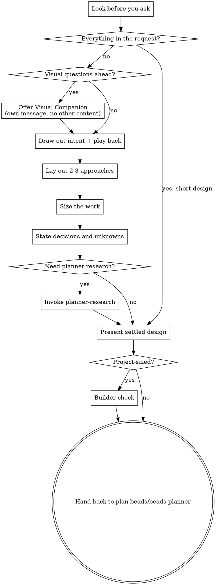

# Brainstorming Ideas Into Designs

Help turn ideas into a settled Beads-ready design through natural collaborative dialogue.

In this template, `brainstorming` is the primary discuss stage. Use it to lock intent, separate decisions from assumptions, and identify any factual unknowns early enough that `planner-research` can resolve them before Beads are created.

Start by reading the project and any context you were given, then draw out what the user wants and why, asking only what changes what gets built. Once you understand what you're building, lay out the approaches, present the settled design, and hand back a settled recommendation for the single bead-creation confirmation in `plan-beads`.

<HARD-GATE>
This is a planner skill. Do NOT invoke any implementation skill, write any code, scaffold any project, claim a bead, or take any implementation action. The goal is a settled design that can flow into `planner-research` or `beads-planner`, not executor planning.
</HARD-GATE>

## First: What Do You Already Know?

Before you reply, ask yourself: what do I know about what they want, and why?

- **Everything that matters is in the request** ("add a dark-mode toggle to the settings page, persisted per user"). Skip the question rounds: your first message states the short design (approach, one line on why the alternatives don't fit, the design in a few lines) and asks them to approve it.
- **Something non-trivial is missing.** Start the conversation below.

"Simple" work is still designed. The design can be a few sentences, but you MUST present it and settle the important decisions before planner handoff.

## Checklist

You MUST create a task for each of these items and complete them in order:

1. **Look before you ask** - read the project and any context they gave before your first message
2. **Offer visual companion** (if the look of something is theirs to decide) - this is its own message, not combined with a question. See the Visual Companion section below.
3. **Draw out intent** - ask only the questions whose answers change what gets built; if they have not said why they want it, that is the first question
4. **Play it back** - describe each part back as you understand it, in chunks
5. **Lay out 2-3 approaches** - in a message of their own, with trade-offs and your recommendation
6. **Size the work** - a small change or a project
7. **State what is already decided vs still unknown** - explicitly separate locked decisions, assumptions, and factual unknowns
8. **Use `planner-research` if needed** - only when unresolved factual unknowns would weaken the design or produce poor Beads
9. **Present the settled design** - scaled to its size, including parallel-execution constraints when the work may be split across worktrees
10. **Builder check** (projects only) - one fresh-subagent pass over the settled design
11. **Stop at planner handoff** - hand the settled design back to `plan-beads`, `planner-research`, or `beads-planner`

## Process Flow

**The terminal state is planner handoff.** Do NOT invoke `writing-plans`, `beads-claim`, or any implementation skill from `brainstorming`.

## Look Before You Ask

In an existing project, or when they've given you context (a spec, an issue, a handoff, files they pointed at, earlier conversation, existing beads), dig in before your first message. Read what they referred to and the code it connects to, and keep reading until you can explain how the relevant parts work today and what this change would touch. Never ask what the project or their context already answers, or reopen what they've already decided.

- Assess scope early: if the request describes multiple independent subsystems (for example, "build a platform with chat, file storage, billing, and analytics"), say so in your first message. Do not spend questions refining details of a project that needs to be decomposed first.
- If it is too large for a single design, help the user decompose into sub-projects: the independent pieces, how they relate, what order to build them. Then brainstorm the first sub-project through the normal flow. Each sub-project gets its own discuss -> plan -> execution cycle.

## The Conversation

**Your first message.** When they've already said what they want, aim for about 200 words: echo the request in your own words (what, who it's for, why as far as they've said), add what you found that bears on it, and say plainly if you found a constraint, conflict, or cheaper path they may not have considered. Then:

- if they haven't said **why** they want it, even if you can guess, ask that: one open question in their own terms, with nothing to pick from
- otherwise, if something open would change what gets built, ask about the one that would change it most, sketching each nameable option with what it trades off and which you'd pick
- otherwise there is one sensible way: end with the short design and ask them to approve it

When they haven't said what they want, ask one open question about the biggest thing their request leaves unsettled, and say what the answer would change about what gets built.

**Asking.** Ask a question only when the answer would change what gets built and neither the request nor the project answers it. Otherwise, state your call and your reason as a proposal they can correct, and move on. Process steps are always your calls — where things go, looking further, how to show something: do them and say so.

- One question per message. Plain language, their vocabulary, no process jargon. Never quote this skill at them.
- Until you know why they want it, ask open questions with no example answers attached. Once you know why, when a decision has choices you can name, sketch each concretely with what it trades off and which you'd pick.
- When they say "just guess" or "what do you think?", propose something concrete.
- Make every question specific: build it on their last answer or on something you found, so it helps them think through a consequence or a case they may have missed.
- **How it gets made** (platform, language, libraries): read from how they talk which of these choices they want to own. Someone who raises the how wants options with your pick; someone who talks about outcomes is handing you the how — make those calls and state each in a line. Any choice you make goes in the design as your call, never as something they agreed to.
- Ground to cover is territory, not a script: why now and what success looks like; goals, non-goals, and anti-goals; prior art; current state; constraints specific to running the work in parallel worktrees if it may later be parallelized.

**Play it back.** As soon as you understand one part well enough to describe it, describe that part back in about 200-300 words, then return to questions about the next part. Only what they said goes in as theirs; anything you filled in goes in as your proposal, with your reason. End each chunk by asking what's wrong or missing.

**Lay out the approaches.** Once you understand what they want, put two or three real ways of building it in a message of their own, grounded in what the project actually does, with what each trades off. Drop any that work against why they want it or that the existing code rules out. Lead with your recommendation and say why, then ask which way to go; if they've handed you the how, say you'll go with your pick. When there is genuinely one sensible way, say so and explain why the others don't fit.

**Size the work.** Say how big it is in plain words; they can override it.

| Size           | The settled design                                                                  |
| -------------- | ----------------------------------------------------------------------------------- |
| A small change | a short one: what you already covered together, a line or two per point             |
| A project      | the full design (below), followed by the builder check                              |

Short or full, the design names the approaches considered, which one was picked, and why. If the work grows mid-conversation, stop, say so, and step up a size.

## Escalating to Planner Research

- Use `planner-research` only for factual unknowns that materially affect the design or bead decomposition.
- Good triggers: unknown integration points, unclear library or platform behavior, uncertain repo conventions, external API constraints, or open feasibility questions.
- Do not use `planner-research` just to avoid asking the user preference questions.
- After research, fold findings into the settled design and later bead descriptions or notes. Do not create a separate planning tracker or second source of truth.

## Presenting the Settled Design

- The design must leave the next planner skill enough structure to create high-quality, fresh-session-safe Beads without replaying the conversation.
- Cover: intent and the why; goals, non-goals, anti-goals; constraints; the approaches and the pick; architecture, components, data flow, error handling, testing; parallel-execution constraints when the work may be split across worktrees; what is left to the executor.
- Scale each section to its complexity: a few sentences if straightforward, up to 200-300 words if nuanced.
- Ask for correction only when something appears wrong, ambiguous, or preference-sensitive enough that the planner should not choose on the user's behalf.

**Design for isolation and clarity:**

- Break the system into smaller units that each have one clear purpose, communicate through well-defined interfaces, and can be understood and tested independently.
- For each unit, you should be able to answer: what does it do, how do you use it, and what does it depend on?
- Smaller, well-bounded units are also easier for you to work with - you reason better about code you can hold in context at once. When a file grows large, that is often a signal that it is doing too much.

**Working in existing codebases:**

- Follow existing patterns. Where existing code has problems that affect the work (a file that has grown too large, unclear boundaries), include targeted improvements as part of the design.
- Do not propose unrelated refactoring. Stay focused on what serves the current goal.

## Builder Check (projects only)

Before handing a project-sized design to the planner, dispatch one fresh general-purpose subagent with `builder-check-prompt.md` (alongside this `SKILL.md`), passing the settled design text inline — never your session history. When you tell the user you're writing the design up, say a reviewer will read it first and you may come back once with a few questions. Sort what the builder asks into three piles:

- **Answered already** by the conversation or the project: add the answer to the design.
- **Minor:** a sensible executor could settle it without changing what gets built. Settle it yourself and mark it in the design as your call.
- **Theirs:** only the user can answer it, and the answer changes what gets built. Ask these in one message, then fold the answers in.

There is one round. Do not re-dispatch the builder after folding in answers. Small changes skip the builder check; `validate-beads` still checks the resulting beads for fresh-session safety.

## Planner Handoff

After the design is settled:

1. State the settled design briefly.
2. List:
   - goals and success criteria
   - locked decisions
   - assumptions (including anything marked as your call)
   - factual unknowns, if any remain
3. If factual unknowns remain that still matter, hand off to `planner-research`.
4. Otherwise hand off to `beads-planner`, usually through `plan-beads`.

Do not:

- write or commit a spec document as part of this template workflow
- invoke `writing-plans`
- claim beads
- start execution

## Key Principles

- **Proposals over questions** - Ask only what changes what gets built; otherwise propose and let them correct.
- **One question at a time** - Do not overwhelm with multiple questions.
- **Why first** - Until you know why, ask open questions with no options; after, name options with your pick.
- **YAGNI ruthlessly** - Remove unnecessary features from all designs.
- **Explore alternatives** - Always lay out 2-3 approaches before settling.
- **Incremental validation** - Play back as you go, tighten weak spots, and reserve the explicit confirmation gate for bead creation in `plan-beads`.

## Visual Companion

A browser-based companion for showing mockups, diagrams, and visual options during brainstorming. Available as a tool - not a mode. Accepting the companion means it is available for questions that benefit from visual treatment; it does NOT mean every question goes through the browser.

**Offering the companion:** When you anticipate that upcoming questions will involve visual content (mockups, layouts, diagrams), offer it once for consent:

> "Some of what we're working on might be easier to explain if I can show it to you in a web browser. I can put together mockups, diagrams, comparisons, and other visuals as we go. This feature is still new and can be token-intensive. Want to try it? (Requires opening a local URL)"

**This offer MUST be its own message.** Do not combine it with clarifying questions, context summaries, or any other content. The message should contain ONLY the offer above and nothing else. Wait for the user's response before continuing. If they decline, proceed with text-only brainstorming.

**Per-question decision:** Even after the user accepts, decide for EACH QUESTION whether to use the browser or the terminal. The test: **would the user understand this better by seeing it than reading it?**

- **Use the browser** for content that is visual - mockups, wireframes, layout comparisons, architecture diagrams, side-by-side visual designs.
- **Use the terminal** for content that is text - requirements questions, conceptual choices, tradeoff lists, A/B/C/D text options, scope decisions.

A question about a UI topic is not automatically a visual question. "What does personality mean in this context?" is a conceptual question - use the terminal. "Which wizard layout works better?" is a visual question - use the browser.

If they agree to the companion, read the detailed guide before proceeding:
`skills/brainstorming/visual-companion.md`
